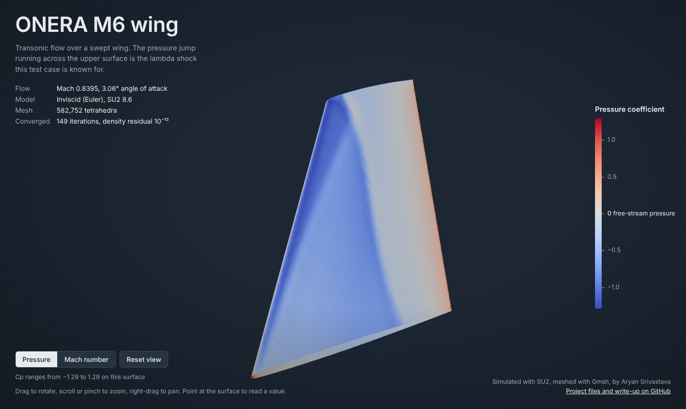
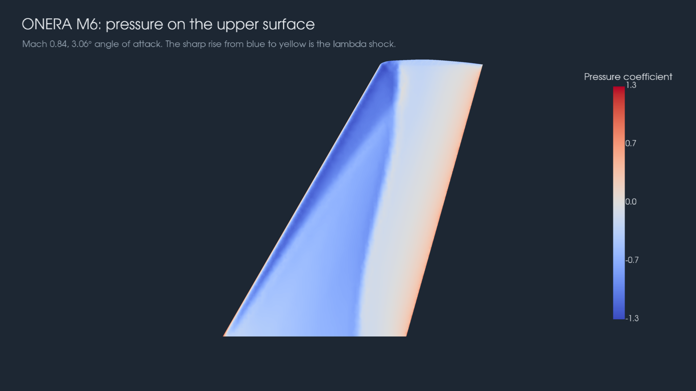
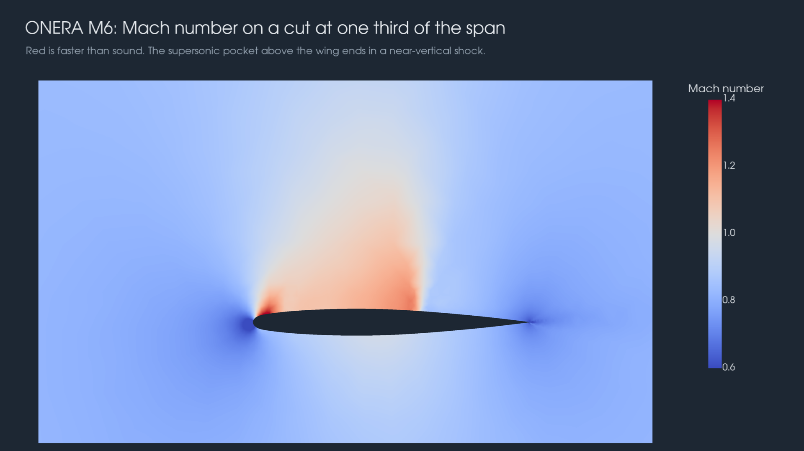
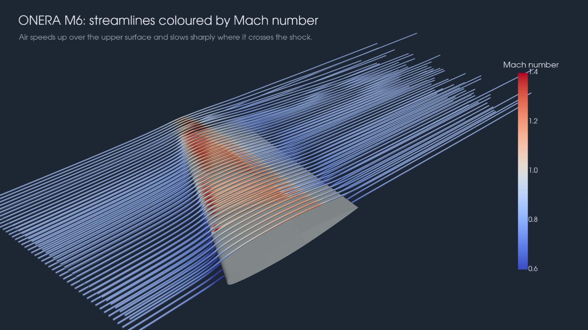
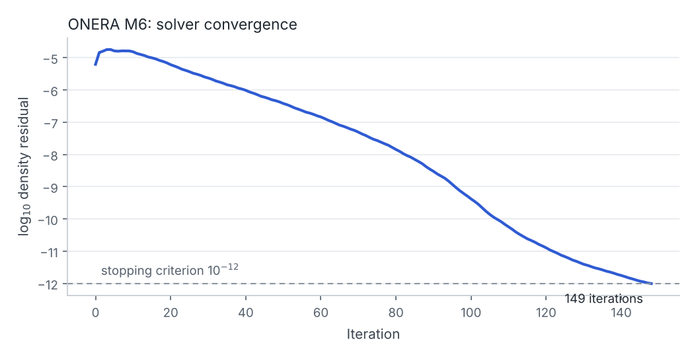

# ONERA M6 wing: transonic CFD with SU2

Inviscid (Euler) simulation of the ONERA M6 wing at Mach 0.84, the standard test case for transonic flow solvers. I ran it with the open-source solver [SU2](https://su2code.github.io) and post-processed it in ParaView, as the first step of a series of aircraft CFD studies.

**[Explore the result in 3D in your browser](https://aryan-1512.github.io/Onera-m6-su2/)**: rotate the wing, switch between pressure and Mach number, and read values directly off the surface.

**[Watch the air flow around the wing](https://aryan-1512.github.io/Onera-m6-su2/flow.html)**: animated streamlines that move at the speed the simulation computed.

[](https://aryan-1512.github.io/Onera-m6-su2/)

## Why this case

The ONERA M6 is a swept, tapered wing tested in the ONERA S2MA wind tunnel in the 1970s. At Mach 0.84 and 3.06° angle of attack, a lambda-shaped shock forms on its upper surface: two shock lines that start apart near the wing root and merge toward the tip. Its geometry and pressure measurements are public, which makes it the usual first case for checking that a CFD setup captures shocks correctly before moving on to new geometry.

## Setup

| | |
|---|---|
| Solver | SU2 8.6, compressible Euler equations (inviscid) |
| Flow | Mach 0.8395, angle of attack 3.06°, sea-level free stream |
| Mesh | 582,752 tetrahedra, half-span wing with a symmetry plane (SU2 tutorial mesh) |
| Numerics | JST central scheme, implicit time stepping, W-cycle multigrid, adaptive CFL |
| Convergence | density residual reduced to 10⁻¹² in 149 iterations |

The configuration file is in [`case/inv_ONERAM6.cfg`](case/inv_ONERAM6.cfg).

## Results

The pressure coefficient on the upper surface shows the expected lambda shock: strong suction (blue) behind the leading edge, ending in a sharp pressure rise that runs from root to tip. A slice through the air at one third of the span shows the supersonic pocket above the wing (peak Mach about 1.3) closing in a near-vertical shock about two-thirds of the way along the chord, while the lower surface stays subsonic.








<!-- Animation placeholder:  -->



## Next step: validation

The next step is comparing the computed pressure coefficient at the standard spanwise stations against the published wind-tunnel data (Schmitt and Charpin, AGARD AR-138, 1979). An inviscid model is expected to place the shock slightly downstream of the experiment, because it has no boundary layer.

## Reproducing the run

1. Install [SU2](https://su2code.github.io/download) and [ParaView](https://www.paraview.org/download/).
2. Download the mesh `mesh_ONERAM6_inv_ffd.su2` from the [SU2 tutorials](https://github.com/su2code/Tutorials/tree/master/compressible_flow/Inviscid_ONERAM6) into `case/`. It is not stored here because of its size.
3. In `case/`, run `SU2_CFD -t 4 inv_ONERAM6.cfg` (`-t` sets the number of CPU threads).
4. Open `surface_flow.vtu` and `flow.vtu` in ParaView.

To refresh the web pages from a new result:

```
python tools/export_surface.py case/surface_flow.vtu docs/data/m6_surface
python tools/trace_streamlines.py case/flow.vtu docs/data/m6_streamlines -0.6 0.05 1.35 "-0.080,-0.051,-0.023,0.006,0.034,0.063,0.091,0.120" 36 3.6
```

## Repository layout

```
case/       SU2 configuration
results/    convergence history and plot
images/     figures used in this README
docs/       the interactive viewer and flow animation (published with GitHub Pages)
tools/      scripts that convert SU2 output for the two web pages
```

## Development note

I set up and ran the simulations in SU2, generated and checked the meshes in Gmsh, analysed the results in ParaView and made the modelling decisions. The supporting scripts (figure rendering and data export) and the web viewers were developed with AI assistance (Claude).

## Credits

The mesh and base configuration come from the official SU2 tutorials. The web viewer uses [three.js](https://threejs.org) (MIT licence).
